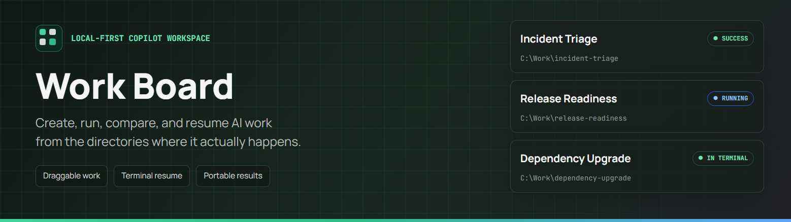
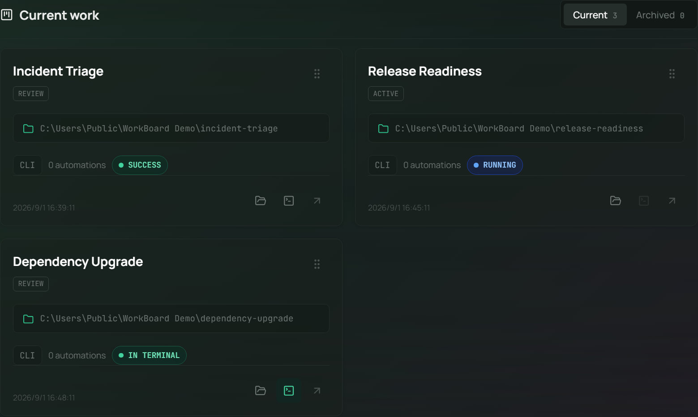
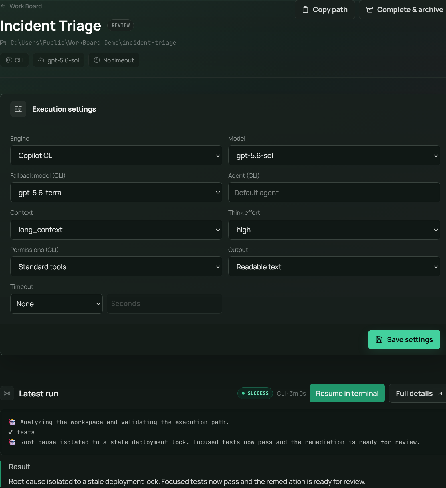

# Work Board

Work Board is a local-first workspace for quickly creating, running, comparing, resuming, and archiving [GitHub Copilot CLI](https://github.com/github/copilot-cli) work. A Work points at a real directory, keeps its prompt beside the resources, and collects portable output for every run.

The existing scheduled task system remains available as **Automations**. The application is still a single Next.js process: UI, API routes, queue, and cron scheduler run together.

Once Work Board is running, open the bilingual [in-app Docs](http://localhost:3100/docs) at `/docs` for the complete feature guide, operational boundaries, and Release Notes.

## Recent updates

- **Selected-folder references:** the New work name strip shows the selected folder's immediate contents, not its siblings. Click a name to insert it at the Prompt caret or replace selected text. [Selection and refresh behavior](#features).
- **Images and files in messages:** Follow Up and Steer now accept paste, drop and file-picker input, including attachment-only messages, with upload progress and retry-safe receipts. [Limits, storage and backup](#work-directory-layout).
- **A focused conversation workspace:** wider details, separate side tabs, a pinned toolbar, bottom-docked composer, expandable Work files and denser messages with folded tool activity. [Work details](#work-details).
- **Safer session continuation:** minute Terminal-history synchronization, explicit IN TERMINAL / SYNCING / TERMINAL states, and checked Resume, Follow Up and immediate Steering paths. [Session behavior](#features).
- **Work Board notifications:** Windows branding and compact metrics, with clicks opening the corresponding Work, standalone Run or test Settings page. OS permissions and native themes still apply. [Notification behavior](#features).
- **Login startup and recovery:** default-on current-user autostart, distinct process/registration status, and a Windows PowerShell 5.1 fix for absent Run values. [Autostart controls](#start-automatically-after-login).
- **Optional comparison UI:** Skill comparison creation remains hidden by default; existing results and APIs stay available. [Configuration](#configuration).

This summarizes the current source, not a new version tag or confirmation that an existing background instance has loaded it. Apply pending migrations and rebuild/restart the serving application when upgrading; see [Release commands](#run-the-release-in-the-background).

## Application tour

### Work Board

Current Work is displayed as a responsive card grid. Drag the card handle to persist a custom order, or use the card actions to open the directory, resume the latest eligible session in Windows Terminal, or inspect the Work.



### Work details

Work details opens **Session conversation first**, with Execution settings, Prompt and Run history in separate side tabs. The latest Run, results, artifacts and Terminal Resume remain accessible without stacking settings below messages. The output setting controls readable text or raw JSON events, and Work timeout defaults to None.

- **Available-width workspace:** Work details and its navigation fill the viewport with 16px mobile / 24px larger-screen gutters. The tab rail and file pane keep their widths, giving the extra space to the conversation; other pages retain their centered layout.
- **One compact toolbar:** Work identity, view switch, Run status, session controls, and shortcuts share one desktop row, pinned below the global navigation. Secondary actions use lightweight text/icons; desktop controls are 32px high, with at least 44px touch targets.
- **Direct actions:** Follow Up focuses the conversation composer; Copy path is an icon with a tooltip and copied confirmation. Explorer, VS Code, Terminal Resume, and archive/restore remain directly accessible.
- **Focused workspace:** Conversation is the default side tab; Execution settings, Prompt, and Run history have separate panels rather than appearing below messages. Switching panels preserves drafts. The history count covers earlier Runs in the loaded list, not the lifetime total.
- **Docked Follow Up:** messages scroll independently while the composer stays at the bottom of the Conversation panel, including the Raw output view. Its background and input surface follow the page theme without a bright white panel. The toolbar's Follow Up action returns to the conversation and focuses the existing draft.
- **Images and files:** paste a screenshot, drop files, or use **Add files** in Follow Up and live **Steer now**. Attachment-only messages are supported. Files stay local to the page until Send, then upload into the owning Work before the instruction is dispatched: at most **25 MiB per file, 10 files and 100 MiB per message**. Upload progress and errors remain inline; a failed attempt preserves the draft and successful receipts for the same-request retry. Switching Work tabs keeps the draft, but a full reload/navigation does not restore unsent browser File objects. Clipboard filesystem-file support varies by browser; selection and drag/drop are alternatives.
- **Responsive controls:** long titles truncate, with the full name available on hover and in Work details. Narrow screens wrap controls and use horizontal section tabs.
- **Denser reading:** session prose uses 13px text with tighter headings, paragraphs, lists, and tables; code remains independently scrollable. Other pages retain their existing typography.
- **Work files:** the right pane lists the current Work directory. Expand folders on demand and open files in a new browser tab; narrow screens use a Files tab. This is read-only, owner-scoped access: redirected folders are not exposed, HTML previews cannot run scripts or access the application origin, unknown formats download, and files larger than 16 MiB report a preview limit.

The session conversation shows retained user/assistant messages across linked Runs, with earlier-history pagination, incremental updates, raw output, and a full session download. Empty prose events do not create empty message bubbles. Tools and runtime metadata are collected into compact activity groups: active progress is shown, then completed activity folds away while the answer stays visible. Matching tool-call IDs combine arguments and results in one expandable entry; failed calls stay marked in the group summary. Turn-end, usage-checkpoint, and stopped events remain inspectable rather than occupying separate full-size rows. The duplicate session-Run and Steering-audit panels are not displayed; stored Run history, Steering records, and inline delivery/error handling are retained. Missing or unrecorded history is not reconstructed from a truncated Run log. Run details show Result and Output before the collapsed Run details section containing repository, process, execution, and related-Run information; status, cancellation, and errors remain visible.

Work cards show the latest Run's actual model usage and total input + output tokens after the Copilot session shuts down. Hover the token count for input, output, cache, and reasoning details. Work Board checks persisted session events for both readable-text and JSON CLI Runs; exit code 0 is not considered success when tools or sub-agents remain unfinished, are cancelled before a root response, or no root-level final response exists. In that case it resumes the same session up to three times before marking the Run failed.



## Features

- **Fast Work creation** — enter or browse to a directory, create and automatically select a child folder when needed, write a prompt, then create and run in one action. Missing directories are created automatically.
- **First Run in Terminal** — create a Work and open a new interactive Copilot session in Windows Terminal with the saved Prompt and CLI settings. Work Board reads session history every minute, including while Terminal is running.
- **Draggable Work cards** — scan Current Work as a responsive card grid and drag cards into a persistent custom order with pointer, touch, or keyboard controls.
- **Conversation-first Work details** — a pinned compact toolbar, sidebar sections, docked composer, and read-only file pane keep messages in focus. See [Work details](#work-details).
- **Card-level local actions** — open a Work directory in Windows Explorer or VS Code, or resume its latest eligible Copilot session in Windows Terminal directly from the card. Active or starting Terminal sessions show **IN TERMINAL**; stopped sessions awaiting history settlement show light-green **SYNCING**.
- **Detail-page shortcuts** — Work and Run detail headers also provide Explorer, VS Code, Terminal Resume, and archive/restore icons. Run-page archive acts on the owning Work (or legacy Automation), not the individual Run history.
- **Common Root directories** — save frequently used roots in New Work, browse their immediate child folders, select a Work directory, or open a root or child folder directly in Windows Explorer. The root dropdown remembers the last selection per user in the same browser across refreshes and browser/server restarts. Removed shortcuts fall back to the first available root; restoring a root does not select a Work directory or load its Prompt. Background Work updates and window-focus refreshes preserve the folder list and in-flight loading; use the directory refresh button to reload its contents. Clearing site storage resets this preference.
- **Prompt file-name strip** — below the New work Prompt, a compact horizontal row lists all immediate files and folders inside the **selected Work Directory**, including dot-prefixed names; it does not recurse. A single click on a left-side folder selects its contents without requiring double-click navigation. Directory input edits, Browse selection, Use current, new folders and copied destinations all update the same source; merely browsing another parent does not. Click or keyboard-activate a name to insert it at the remembered caret, replacing selected text and restoring Prompt focus. Only the original name is inserted, with separating spaces as needed: no path prefix, file read or upload. The strip labels its selected directory and has its own refresh/retry action; an unselected, missing or unreadable directory never falls back to parent-folder contents.
- **Prompt templates** — fill, append, or replace prompt text with built-in workflows, and manage or import reusable Markdown and plain-text templates in Settings.
- **Portable prompts** — `PROMPT.md` is the source of truth and autosaves with external-edit conflict detection. New Work can read an existing top-level `Prompt` (no extension), `PROMPT.md`, or numbered Prompt file without changing it; multiple Works sharing one directory use `PROMPT-2.md`, `PROMPT-3.md`, and so on.
- **Numbered folder copies** — confirm and copy the selected directory to the next monotonic sibling (`work-2`, `work-3`, and so on), open the copy in Explorer for edits, then return to write the Prompt and run it. Copies include hidden files, `.git`, dependencies, and build output.
- **Resource initialization** — start from the selected local path or copy a registered Resource into a new Work directory.
- **Dual engines** — use the existing Copilot CLI runner or the official `@github/copilot-sdk`. CLI is the default.
- **Explicit Work execution settings** — configure engine, agent, primary and fallback models, context size, reasoning effort, permissions, and readable or raw JSON output per Work. Every Run freezes those settings for later inspection.
- **Execution defaults** — set shared Work and Automation defaults in Settings; new items inherit them while existing saved settings remain unchanged.
- **Optional Work timeout** — Work runs default to no timeout, but each Work can set a 30–86400 second limit. Automation timeouts remain independently configurable.
- **Skill comparisons (opt-in UI)** — set `WORKBOARD_SHOW_SKILL_COMPARISON="true"` and restart to show the creation panel. It is hidden by default; existing results and experiment APIs remain available. Discover project Skills or add a local directory, freeze one resource snapshot, then run isolated copies with explicit `/skill-name` or automatic invocation.
- **Live and resumable runs** — stream output, cancel managed Runs, and resume the exact Copilot session in Windows Terminal from a Work card, Work details, or Run details. External Terminal Runs must be stopped in Terminal, not with Work Board's Cancel action. Detail-page status checks run independently of conversation and raw-output loading, including the first response, periodic polling, and tab focus. Activity-check failures stay visible and do not enable an unverified Resume.
- **Terminal history and settlement** — a server-side minute timer checkpoints history while Terminal runs and catches up on startup. Once Terminal stops, **SYNCING** separates physical inactivity from unfinished settlement without changing the persisted Run outcome. After a minute of stable stopped history, the Run settles using its saved exit code or complete response evidence; closing a window alone does not mean success. Incomplete histories remain light-green **TERMINAL** (`UNKNOWN`) and can recover later; callback and manual Sync are no longer used. Resume and inline Follow Up may first settle a stopped parent, then recheck session locks, history, source state, and conflicting Runs; failed checks remain explicit rather than force-starting another session. Token/model totals appear when Copilot persists usage events, typically at session shutdown.
- **In-app Follow Up and live Steering** — while a managed Work Run is active, “Steer now” sends an immediate instruction to that exact live CLI or SDK session; transport acceptance is shown separately from model application. Accepted instructions are recorded against the Run, retained in its `steering.jsonl` audit artifact and appended once to Prompt with a per-message marker. If Prompt or audit repair fails, retrying the same request ID repairs local records without resending to Copilot. Ambiguous delivery is never replayed automatically. Steering does not undo edits or guarantee stopping a running tool. Steering is unavailable for external Terminal sessions and legacy Runs without a live controller. When no managed Run is active, Follow Up creates a separate linked Run and attempts its idempotent Prompt append before enqueueing; a deferred append is retried during execution. Rejected submissions retain the conversation draft, and a same-request retry returns the existing Run rather than creating another.
- **Quiet Windows background execution** — background CLI lookup and managed runtime startup keep their console windows hidden. Live Steering sends over the existing runtime connection. Explicit Open Terminal/Resume and Open VS Code actions still open their requested visible windows.
- **Default-on login autostart** — successful background start/restart registers current-user login startup on Windows, macOS, or Linux with systemd user services. Explicit background stop removes registration; `WORKBOARD_AUTOSTART=false` disables it. See [login startup and recovery](#start-automatically-after-login).
- **Controlled CLI runtime** — new CLI-engine Work Runs use the installed Copilot CLI’s headless stdio/RPC channel, with the SDK as transport only; the Work engine remains `CLI`. This enables same-session Steering without terminal keystrokes, remote-control export, or a second session. CLI custom-agent discovery is enabled. Permission scope remains `--allow-all-tools` by default and `--allow-all` only for the full permission setting. Existing `copilot -p` Runs are not converted and cannot be attached. The public SDK does not expose the spawned CLI PID, so PID/CPU/memory fields are unavailable for these controlled CLI Runs; raw output is the headless JSON event stream rather than the former `-p` text rendering. Session usage accounting continues to use Copilot’s persisted session usage events. Completion waits for runtime shutdown; a session-disconnect or runtime-stop failure fails the Run rather than reporting success.
- **Session compatibility repair** — read legacy Copilot permission events during history synchronization and safely upgrade them before Resume, with an atomic backup and active-process protection. Periodic reads never rewrite Copilot history.
- **Portable results** — every Work, Experiment, terminal-resume, and Automation run writes `result.md`, `transcript.jsonl`, `diff.patch`, `run.json`, `stdout.log`, and `stderr.log`.
- **Background system notifications** — receive host OS notifications for successful, failed, or timed-out Work and Automation Runs even when every browser tab is closed. Windows toasts use the Work Board name and green icon, with a compact status/name/metrics layout. Select one to open its Work; standalone Automations open their Run. Experiments notify once and link to their Work. Configure or test notifications in Settings.
- **Archive without deleting** — completed Work and Automations can be archived and restored while keeping directories, sessions, and history.
- **Automations** — existing manual, cron, signed GitHub webhook, and token-authenticated API triggers remain compatible.
- **Inline Resources** — select, add, edit, or remove an Automation Resource directly in New Automation; there is no separate Resource workspace to manage.
- **Light and dark themes** — follow the operating system on first use, then persist an explicit theme selected from the navigation bar.

## Tech stack

Next.js 16 (App Router, Turbopack) · React 19 · TypeScript · Tailwind CSS v4 · dnd-kit · Prisma 7 + SQLite · GitHub Copilot CLI + Copilot SDK · Vitest · Auth.js with Microsoft Entra ID.

## Work directory layout

```text
my-work/
├── PROMPT.md
├── project resources...
└── .workboard/
   ├── index.json
   ├── works/<work-id>.json
   ├── attachments/<work-id>/<message-id>/
   │   ├── manifest.json
   │   └── <file-id>-<safe-name>
   ├── outputs/<run-id>/
   │   ├── result.md
   │   ├── transcript.jsonl
   │   ├── diff.patch
   │   ├── run.json
   │   ├── stdout.log
   │   └── stderr.log
   └── variants/<work-id>/<experiment-id>/...
```

`.workboard/` is excluded when Work Board copies a Work, preventing recursive copies. It is otherwise ordinary, inspectable local data and should be included when backing up the Work.

Message attachments remain under the **owning Work**, even when its resumed Run executes in another directory. Prompt and Run/Steering snapshots retain attachment references; managed CLI and SDK sessions receive actual file attachments, not just path text. Accepted files are not automatically deleted, including files saved before a later send failure, so back up the attachment directory together with SQLite and session history. Attachments are excluded from managed Git snapshots and Work/experiment copies with the rest of `.workboard/`; they are not executed, unpacked, installed, or imported as skills.

Conversation attachment links are authenticated and Work-owner scoped. Sniffed PNG/JPEG/GIF/WebP images can display thumbnails and open in a new tab; other formats download without active HTML/SVG execution. The attachment download route handles the full accepted 25 MiB size; the ordinary Work-file preview limit remains 16 MiB. Model support for images/documents varies: transport acceptance is not proof that the selected model understood the file. Terminal-owned and disconnected legacy sessions remain read-only.

**Upgrade and backup:** apply the [attachment metadata migration](prisma/migrations/20261023080000_work_message_attachments/migration.sql) before starting the updated application, then rebuild/restart the serving Release. It adds nullable attachment metadata to Run and Steering history without requiring attachments on older records. Back up the Work directory (including retained attachments), the configured SQLite database and app `data/`, and Copilot session history under `COPILOT_HOME` (default `~/.copilot`). Updating source or enabling an autostart flag alone does not perform this upgrade.

## Getting started

### Prerequisites

- Node.js and npm
- The [GitHub Copilot CLI](https://github.com/github/copilot-cli) (`copilot`) installed and authenticated (interactive `/login`, or a `GH_TOKEN`/`GITHUB_TOKEN` env var with the "Copilot Requests" permission)
- `git` on your `PATH`
- Optional: a Microsoft Entra ID (Azure AD) app registration when sign-in is required — see [Authentication setup](#authentication-setup) below

### Configure the environment

Copy [`.env.example`](.env.example) to `.env` in the application root before using either development or Release commands. Leave both Microsoft Entra credential values empty for login-free local mode, or fill in both credentials and `AUTH_SECRET` to require sign-in.

For [background Release commands](#run-the-release-in-the-background), login autostart defaults to enabled. Set `WORKBOARD_AUTOSTART="false"` before starting if you do not want a persistent login entry; this does not prevent manual startup.

### Run in dev mode

```bash
npm install
npm run quickstart   # generates the Prisma client, applies migrations, then starts `next dev`
```

Or step by step:

```bash
npm install
npx prisma generate
npx prisma migrate deploy
npm run dev
```

Open [http://localhost:3100](http://localhost:3100).

### Run a Release (production) build

Dev mode rebuilds on every request and isn't meant for long-running/scheduled use. To run the optimized production build instead:

```bash
npx prisma migrate deploy  # only needed if there are new migrations
npm run build              # prebuild generates Prisma Client automatically
npm run start              # runs `next start -p 3100` — serves the build, no hot-reload
```

The `node-cron` scheduler starts automatically in both dev and production mode, as long as the process keeps running — see [Scheduling notes](#scheduling-notes) below.

### Run the Release in the background

The same commands work in PowerShell/Command Prompt on Windows and Terminal on macOS/Linux. The start command generates Prisma, applies migrations, builds the release, then launches Work Board detached from the terminal with output redirected to `data/`.

**Login autostart is enabled by default.** A successful background start/restart also registers startup for the current user on Windows, macOS, or Linux with a working systemd user manager. Set `WORKBOARD_AUTOSTART="false"` in `.env` before starting if you do not want this persistent login entry.

```bash
npm run background:start
```

The terminal can be closed after the command reports that Work Board started. Choose the command by its process and login-registration effects:

| Command | Application process | Login registration |
| --- | --- | --- |
| `npm run background:start` | Prepare and start the Release when stopped; reuse a healthy managed instance if already running | Reconcile with `WORKBOARD_AUTOSTART` after readiness |
| `npm run background:restart` | Stop, prepare, and start the updated Release | Reconcile after the new process is ready |
| `npm run background:start:fast` | Start the existing prepared Release without generation, migration, or build | Reconcile after readiness |
| `npm run background:restart:fast` | Stop and start the existing Release without rebuilding | Reconcile after readiness |
| `npm run background:stop` | Stop the managed process, if running | Remove the owned entry, even if already stopped |
| `npm run background:status` | Inspect managed PID and HTTP readiness | Report registration and configured intent |
| `npm run background:logs` | Read server and bootstrap diagnostics; leave the process running | No change |

Use the full `background:restart` after pulling code, changing dependencies, or adding migrations. Preparation generates Prisma, applies pending migrations, and builds the Release; the fast commands require those steps to have been completed already.

Background startup and status require HTTP 200 from `/api/health`. This uncached, public endpoint returns only `{"status":"ok"}` in both login-free local and Entra modes; it checks HTTP serving, not database or external-service availability. Authentication endpoints remain disabled (HTTP 404) in local mode and are not used for readiness.

### Start automatically after login

After registration, the current user's next login starts the prepared Release without opening a terminal or browser. Login startup never installs dependencies, rebuilds, migrates the database, or submits a new Copilot instruction.

Configure the policy in the application-root `.env`:

```dotenv
WORKBOARD_AUTOSTART="true"
```

**Default-enabled does not mean registered on checkout.** Create the login entry through a successful background start/restart or `autostart:sync`. Plain `start`, `dev`, `quickstart`, `build`, and dependency installation do not register login startup.

- **Start/restart:** reconcile login registration after the process is HTTP-ready, including when the exact same managed checkout is already running.
- **Stop:** `npm run background:stop` stops the managed process **and removes its owned login entry**, even if the process is already stopped or its PID state is stale. It does not change `.env`. A later successful background start/restart can register it again.
- **Disable:** set `WORKBOARD_AUTOSTART="false"`. An existing login launcher rereads the checkout's `.env` and skips startup on the next login. To remove registration immediately without stopping a running server, use `npm run autostart:sync`.
- **Re-enable:** set the flag to `true`, then use a background start/restart or `npm run autostart:sync`. Changing the file alone cannot recreate an entry previously removed by stop/remove.
- **No watchdog:** intentional stops and process exits are not immediately restarted. There is no KeepAlive/Restart policy.

Inspect or manage login registration separately from application process state. These commands **do not start, stop, or restart the web application**:

| Command | Effect |
| --- | --- |
| `npm run autostart:status` | Show configured intent, actual registration, checkout ownership, and entry/log paths |
| `npm run autostart:sync` | Apply the policy: register for true/default, or remove registration for false |
| `npm run autostart:remove` | Remove owned registration regardless of the flag, including an invalid value |

Missing or empty `WORKBOARD_AUTOSTART` means `true`; `true`/`false` are case-insensitive and whitespace is ignored. Other values are errors, but cannot prevent explicit stop/remove. The app-root `.env` takes precedence over an inherited value for this flag; other runtime variables retain normal environment-over-dotenv precedence. There is no configuration watcher, and changing the flag does not kill the running server.

Registration and process success are reported separately. If the server starts but registration fails, it stays running and the command reports an error; fix the cause and retry `autostart:sync` rather than rebuilding. If stop cannot remove registration or stop its managed process, it attempts both operations and reports the partial failure. Never force-kill an unrelated listener or reuse a PID belonging to a different process.

On older script versions, `Cannot inspect the current-user Work Board Run entry` can be a Windows PowerShell 5.1 serialization defect rather than an access denial: a missing Run value becomes `$null`, and `ConvertTo-Json` emits no text for a bare null. Updated scripts use a validated object envelope so a missing entry is reported as **absent** while permissions, execution failures and malformed responses still fail explicitly. Read-only `autostart:status` does not create the entry. Updating these scripts needs no application restart; only run `autostart:sync` when you intend to change this checkout's current-user registration, after addressing any remaining WSH/ACL/policy errors.

#### Platform requirements and recovery

- **Windows:** a checkout-specific `workboard-<id>` value under `HKEY_CURRENT_USER\Software\Microsoft\Windows\CurrentVersion\Run` invokes an owned JScript launcher through Windows Script Host with its window hidden. No administrator rights or VBScript are needed. WSH must be enabled by policy; the Run command must fit its 260-character limit, and the launcher location cannot contain `%`. Windows may delay login items. The helper and `bootstrap.log` live under `%LOCALAPPDATA%\WorkBoard\autostart\workboard-<id>`.
- **macOS:** a current-user `com.workboard.<id>.plist` in `~/Library/LaunchAgents` starts in the GUI login session, without KeepAlive, and ends at logout. `launchctl` must be available in that user's GUI session. Bootstrap logs live under `~/Library/Application Support/WorkBoard/autostart/workboard-<id>`.
- **Linux:** a `workboard-<id>.service` in `${XDG_CONFIG_HOME:-~/.config}/systemd/user` is enabled for the user manager, with no Restart policy. A working `systemctl --user` session is required; non-systemd environments, containers without a user manager, and WSL-specific startup are not supported. Linger is not changed: an already enabled linger policy can start the user manager at boot rather than first login. Inspect pre-Node failures with `journalctl --user -u workboard-<id>.service`; additional metadata/diagnostics live under `${XDG_STATE_HOME:-~/.local/state}/workboard/autostart/workboard-<id>`.

Native definitions contain absolute executable/checkout paths and a non-secret executable search path, not copies of tokens, database credentials, or the complete shell environment. Keep the checkout and recorded Node/tool paths available; after moving the checkout or changing Node installations, remove the old registration and reconcile from the new location. Registration refuses redirected, foreign, or externally changed owned files rather than overwriting them.

If Node or the checkout was removed and application commands cannot run, use the native entry location/ID printed by `autostart:status` to disable/remove **only that checkout's entry**. On Windows inspect the helper's `bootstrap.log`; on macOS inspect its bootstrap log/LaunchAgent; on Linux inspect the user journal/unit. Do not remove other login items or system-wide services.

System notifications are emitted by this background process, not by the browser. They appear on the machine running Work Board and require an interactive desktop session plus OS notification permission. Delivery is at-most-once: a claimed notification is never repeated after restart.

On Windows, the first notification prepares a current-user, installation-specific Work Board identity and Start menu notification shortcut. It needs no administrator rights and does not create a login/startup entry. Keep `scripts/workboard-notify.ps1`, `scripts/notification-shortcut.cs`, and the two `public/workboard-notification` icon assets with the installed application. Identity metadata lives under `%LOCALAPPDATA%\WorkBoard\Notifications\WorkBoard.Desktop.<id>`; only matching owned metadata/shortcuts can be updated or removed. If setup is denied or these artifacts were changed externally, the failure is reported rather than falling back to SnoreToast branding.

Windows controls the native notification frame, fonts, and light/dark appearance; the web site's CSS cannot override them. Work Board supplies its app name, green icon, bounded Work name, and accurate short metrics. The notification itself carries an HTTP(S) link, so selecting it works after the sender helper exits; it does not require an open browser tab or start a new Run. A Work-linked Automation or Experiment opens the corresponding Work; a standalone Automation opens its Run. The test notification opens Settings. Links use the `AUTH_URL` origin, defaulting to `http://localhost:3100`; configure a browser-reachable HTTP(S) root URL without credentials, query, or fragment. If the server is stopped or sign-in is needed, normal browser/authentication behavior applies.

“Submitted” means Windows accepted the notification, not that the user saw a banner. Focus Assist, Do Not Disturb, and per-app OS policy may suppress it. Settings exposes native setup/submission errors; notifications already claimed are not silently replayed. Previously issued SnoreToast notifications are not updated retroactively. macOS/Linux retain their existing notification adapters and platform requirements; Windows branding/activation behavior is not a cross-platform guarantee.

## Authentication setup

Work Board chooses its authentication mode from the two Microsoft Entra environment variables:

- **Login-free local mode:** leave both `AUTH_MICROSOFT_ENTRA_ID_ID` and `AUTH_MICROSOFT_ENTRA_ID_SECRET` empty. All Next.js entrypoints bind to `127.0.0.1`, requests must use a loopback host, and data is owned by a persistent `workboard-local-user` database record. `AUTH_SECRET` is not required.
- **Microsoft Entra mode:** set both variables and `AUTH_SECRET`. The existing Microsoft sign-in and per-user ownership behavior remains enabled. Setting only one Entra variable is rejected at startup.

Local and Entra users have different owner IDs, so switching modes does not merge or expose one mode's Works, Automations, tokens, or settings in the other mode.

To configure Microsoft Entra mode:

1. **Create the app registration** (supports both work/school and personal Microsoft accounts):
   ```bash
   az ad app create --display-name "Work Board" \
     --sign-in-audience AzureADandPersonalMicrosoftAccount \
     --web-redirect-uris "http://localhost:3100/api/auth/callback/microsoft-entra-id" \
     --enable-id-token-issuance true
   ```
2. **Create a client secret** for the app you just created (use its `appId` from the previous step's output):
   ```bash
   az ad app credential reset --id <appId> --display-name "workboard-nextauth" --years 2
   ```
3. **Create a service principal** so consent/sign-in works:
   ```bash
   az ad sp create --id <appId>
   ```
4. **Add the env vars** to `.env` (see the table below) using the `appId` and secret from steps 1–2, plus a freshly generated `AUTH_SECRET`:
   ```bash
   node -e "console.log(require('crypto').randomBytes(32).toString('base64'))"
   ```
5. For a non-localhost deployment, add its callback URL (`https://<your-domain>/api/auth/callback/microsoft-entra-id`) as an additional `--web-redirect-uris` entry on the app registration, and set `AUTH_URL` to that domain.

No `AUTH_MICROSOFT_ENTRA_ID_ISSUER` is set intentionally — omitting it makes Auth.js default to the `common` endpoint, which is required for personal Microsoft accounts (not just organizational ones) to be able to sign in.

## Scheduling notes

Scheduled tasks are driven entirely by the Node.js server process (`instrumentation.ts` → `node-cron`), not by the browser — a task will still fire on schedule even if no browser tab is open. What _does_ matter is keeping the server process itself alive continuously:

- Don't let the machine sleep/hibernate while relying on schedules (suspends all timers). While the server is running, Work Board automatically prevents idle system sleep on Windows (via `SetThreadExecutionState`) and macOS (via `caffeinate`); the display may still turn off normally. Set `CODEBOARD_PREVENT_SLEEP=false` to disable this. On Linux, configure sleep inhibition at the OS/service level.
- Use the background commands for terminal-independent operation and default current-user login startup. This is not a crash-restart supervisor or a system service: it does not start before login (except existing Linux linger behavior), and explicit background stop removes login registration.
- There's currently no "catch up on missed runs" — if the process was down when a scheduled time passed, that run is simply skipped.

## Configuration

| Env var                           | Purpose                                                                                       |
| --------------------------------- | --------------------------------------------------------------------------------------------- |
| `DATABASE_URL`                    | SQLite connection string, defaults to `file:./dev.db` (see `.env`)                            |
| `GH_TOKEN` / `GITHUB_TOKEN`       | Optional PAT for headless Copilot CLI auth (needs "Copilot Requests" permission)              |
| `AUTH_MICROSOFT_ENTRA_ID_ID`      | Optional client ID; leave this and the client secret empty for loopback-only local mode       |
| `AUTH_MICROSOFT_ENTRA_ID_SECRET`  | Optional client secret; must be set together with the client ID                               |
| `AUTH_SECRET`                     | Random Auth.js session secret; required when Microsoft Entra mode is enabled                  |
| `AUTH_URL`                        | Browser-reachable deployment root (e.g. `http://localhost:3100`), used for OAuth callbacks and native notification links; notification targets use its HTTP(S) origin. |
| `AUTH_TRUST_HOST`                 | Set to `true` when running behind a reverse proxy or on a non-standard host/port              |
| `CODEBOARD_PREVENT_SLEEP`         | Set to `false` to disable automatic Windows/macOS idle-sleep prevention                       |
| `WORKBOARD_AUTOSTART`             | Default `true`; register current-user login startup on successful background start/restart. Explicit background stop removes registration; `false` permits manual startup without login registration. |
| `WORKBOARD_SHOW_SKILL_COMPARISON`  | Default `false`; set to `true` and restart to show the Skill comparison creation UI on non-archived Works. Hides only the builder and its initial Skill scan, not results or APIs. |
| `WORKBOARD_ENABLE_LOCAL_TERMINAL` | Allow a trusted non-localhost request to open Windows Terminal on the server; default `false` |

Application-local state — SQLite (at the configured `DATABASE_URL`), compatibility logs, terminal launch metadata and auto-cloned Resources — lives with the app, normally in `dev.db` and `data/`. Work prompts, experiment copies, results and retained message attachments live in each Work directory. Copilot conversation history is separate, under `COPILOT_HOME` (default `~/.copilot`); preserve all of these locations when backing up.

## Operational boundaries

- Work Board is designed for one trusted machine and one Next.js server instance. Queue state is recovered after restart, but there is no distributed lock for multiple application replicas.
- Running two agents directly in the same directory is allowed and clearly marked unsafe: file changes and diffs may be mixed. Use the numbered-copy option or Skill variants when result attribution matters.
- Full copies can be large because they intentionally include dependencies, build output, hidden files, and Git metadata. Check available disk space before large comparisons.
- Windows Terminal resume is only offered for sessions created on the same host. Remote deployments should leave local terminal launch disabled.
- Minute history sync requires the Work Board server to remain running on the same host. It tracks registered Terminal Runs, not every session in a directory. Completed Run history is frozen; resume through Work Board to register another Run. The VS Code button currently opens the directory only, without native Chat session handoff or a new Run.
- Apply new migrations before starting the updated server. Stop the previous server first: periodic history sync replaces callback token/expiry columns in `TerminalLaunch`. Existing Runs and launch records are preserved. A running session launched by an older script can still be recovered from its saved exit code/history, even though its old callback no longer exists.
- Work processes receive an environment allowlist. Auth.js, Entra, and database secrets are not forwarded to Copilot.
